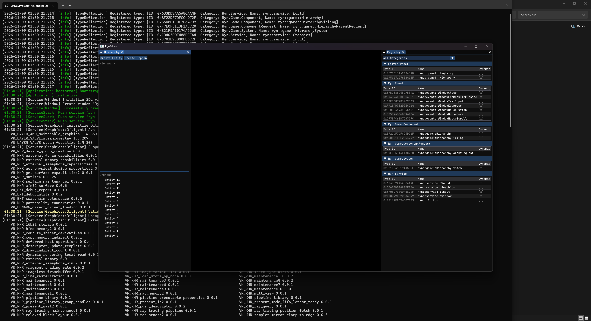

# Ryn Engine

An ECS-based game engine and editor written in modern C++23, inspired by O3DE and Diligent Graphics.



## Highlights

- **ECS core** built on EnTT, with a service stack (window, input, graphics, world) driving the application lifecycle.
- **Runtime reflection**: types register with stable IDs and categories (services, components, systems, events). The editor's Registry panel is built directly on top of it.
- **Rendering through Diligent Engine**: Vulkan everywhere, Direct3D 11/12 on MSVC builds.
- **Editor** built with Dear ImGui (docking), with Hierarchy and Registry panels.
- **DLL-safe by design**: the runtime ships as a shared library, with containers such as `Box<T>` that carry their deleter across DLL boundaries.
- **Strict build**: C++23 modules throughout, no RTTI, no exceptions, warnings as errors.

## Project layout

| Path | Contents |
|---|---|
| `ryn-runtime/` | Engine runtime (shared library): core, containers, reflection, services, world |
| `ryn-editor/` | Editor executable: ImGui backend and editor panels |
| `dependencies/` | CMake FetchContent scripts for all third-party libraries |
| `script/` | Helper scripts |

## Building

**Requirements:** CMake 3.28+, Ninja, and a C++23 compiler with module support (currently only supporting Clang 18+ or LLVM-Mingw Clang on Windows). All dependencies (Diligent, EnTT, SDL3, ImGui, spdlog, glm) are fetched automatically on the first configure.

```sh
cmake -S . -B cmake-build-debug -G Ninja -DCMAKE_BUILD_TYPE=Debug \
  -DCMAKE_C_COMPILER=clang -DCMAKE_CXX_COMPILER=clang++
cmake --build cmake-build-debug
```

The editor is written to `cmake-build-debug/bin/RynEditor`.

| Build type | Engine config |
|---|---|
| `Debug` | Debug: assertions and full logging |
| `RelWithDebInfo` | Release: optimized, with debug info |
| `Release` | Distribution |

Tested on Windows with llvm-mingw (Clang 23, UCRT). On MinGW builds, Direct3D is disabled because Diligent's D3D backends require ATL, which ships only with MSVC.

## Status

Early development. The runtime, reflection system and editor shell are in place. Rendering beyond the editor UI, asset handling and scripting are next.

## License

See [LICENSE](LICENSE).
